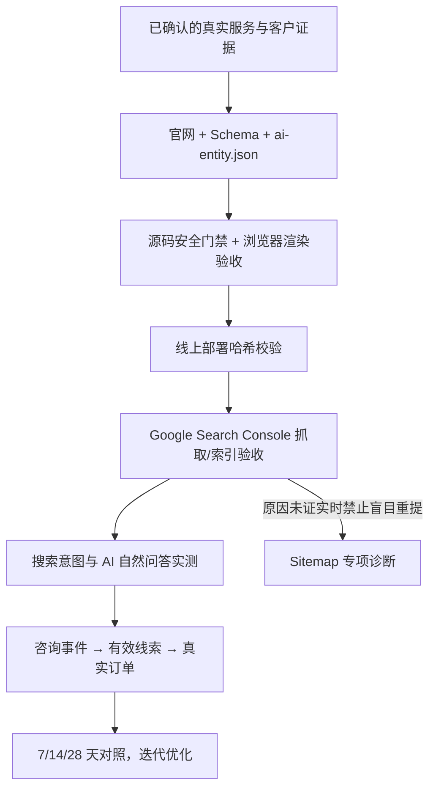

# SEO / GEO 可核验闭环执行计划（2026-11-19）

状态定义：**DONE**=本分支源码修改完成；**CI_PENDING**=须检查真实 GitHub Actions 结果；**EXTERNAL_PENDING**=无法通过源码测试证明或需要业务负责人证据。

## 当前闭环架构

## P0 可信度修复

- DONE：停止在官网显示未提供来源证明的 4.99 综合评分、脚本轮播评价与动态改写姓名/日期行为。撤下三种语言中的未经核验的评价源数据，保留服务咨询区与中立说明。**并非判定全部旧评价虚假**，而是尚无能核实的出处和授权。
- DONE：删除空运 48 小时、陆运 7–15 天、海运 20–30 天的固定宣传时效，改为实际线路逐票确认。三种语言同步。
- DONE：`ai-entity.json` 的 `services` 不再把暂未开放的海运当成现有服务，单独使用 `unavailableServices` 标注。
- DONE：为上述高风险文案建立回归测试和内联 JavaScript 语法验收。
- CI_PENDING：GitHub Actions 检查、390px/1440px 渲染截图、线上部署哈希一致性。

恢复展示客户评价的条件：每条评价均有原始来源、获得展示许可、合理脱敏、真实日期及货物情形，确认身份与订单后由负责人审核；不自动生成姓名、日期或评分；严禁通过自有网站的 Organization/LocalBusiness 自评 Schema 冒充 Google 星级富结果。

## P0 Google Sitemap 无法抓取

- 已知：GitHub runner 在此前轮次验证 Sitemap HTTP 200、28 个有效 URL、线上与源码一致。
- 仍待验证：GSC Sitemaps 详情显示「无法抓取」；官方 API `isPending=true`、`lastDownloaded=null`。二者不等价于 Googlebot 被 robots 阻止。
- EXTERNAL_PENDING：只读获取 GSC 站点地图**详情**、错误原因、网址实时检测、Googlebot 可抓取性与页面索引详情。只根据可复现的具体原因修复；不得无原因重提 Sitemap、改写 robots 或更换域名。

## P1 获客实证与数据质量

- 已有：官网自建 AdsLeadTracker / Cloudflare Worker 客户行为接口，包括 visit/event/contact、UTM 和 fallback。
- EXTERNAL_PENDING：Owner 账号验证 Worker 数据库存储、咨询按钮是否重复记录、是否真正发起客户对话、是否对应有效线索与成交订单。禁止用按钮点击次数宣称订单数。
- EXTERNAL_PENDING：ChatGPT、Gemini、豆包、Kimi、DeepSeek 使用固定、无品牌客户问题开展真实引用抽样，保存原文、日期、模型版本（可知时）和引用 URL。
- EXTERNAL_PENDING：7/14/28 天搜索效果需可比基线；GSC 随机抽样不足以证明全站提升。

## P2 稳定性与性能

- 待执行：手机端 Lighthouse / CWV；首页大量内联 CSS/JS 先找功能覆盖与冲突，再拆分可缓存资源。保留真实浏览器截图回归。
- 待执行：独立检查管理员 token 在 localStorage 与 URL query 的风险，后端未确认兼容前不要强制替换认证。

**不新增定时任务**：沿用已有 SEO 每日 GSC 和每周拓词运行；关闭问题应以真实证据为准。
